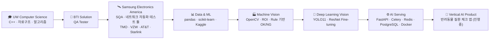

<!-- ============================================================
     yonghoonchoi88 / yonghoonchoi88 (profile README)
     이 파일을 "yonghoonchoi88"이라는 이름의 Public 저장소 루트에 두면
     GitHub 프로필 첫 화면에 표시됩니다.
     ============================================================ -->

<div align="center">


<a href="https://github.com/yonghoonchoi88">
  
</a>

**검증하는 엔지니어가 만드는 Vision AI** · *I build vision systems the way a QA engineer would test them.*

</div>

---

## 👋 About me

미국 **삼성전자(Samsung Electronics America, Bellevue WA)** 에서 위성·모바일 네트워크 **자동화 테스트 툴**을 개발하며 5년 넘게 소프트웨어 품질을 책임져 온 **SQA 엔지니어**였고,
지금은 그 경험을 들고 **현장 데이터 기반 Vision AI**로 영역을 넓히고 있습니다.

- 🎓 **University of Washington** 컴퓨터공학 학사 (2022) — 자료구조 · 알고리즘 · OOP · C++
- 🛰️ **Samsung Electronics America** — SQA, T-Mobile · Verizon · AT&T · **Starlink** 대상 위성/모바일 네트워크 자동화 테스트 툴 개발
- 🧪 **BTI Solution (US)** — QA Tester
- 🏭 **비솔 「현장 데이터 기반 Vision AI & 산업분야 Vertical AI 융합 전문가 양성」 7개월 과정** — 머신비전 · 딥러닝 · 모델 서빙 · 팀 프로젝트

저는 모델을 **"돌아가게"** 만드는 데서 멈추지 않습니다.
**데이터 점검 → 기준선 → 실패 분석 → 변수 하나씩 개선 → 한 번만 보는 Test → 회귀 테스트 → 서빙 → 문서화**까지,
QA에서 몸에 익힌 방식 그대로 끝까지 검증합니다.

---

## 🧭 Career Journey



---

## 🧬 Professional Identity

```text
Software QA / Test Automation Engineer   (5+ yrs, Samsung Electronics America)
Machine Vision Inspection Developer      (OpenCV · Rule-based OK/NG)
Deep Learning Vision Engineer            (YOLO11 · ResNet · Fine-tuning)
AI Model Serving Backend Developer       (FastAPI · Celery · Redis · Docker)
Data Labeling & QA Tool Builder          (900장 이중 교차검수 파이프라인)
```

서로 떨어져 보이는 경험을 **"믿을 수 있는 AI 검사 시스템"** 하나로 연결하는 것이 제 강점입니다.

- **QA × AI** — 테스트 설계, 회귀 테스트, 실환경 장애 테스트로 모델과 서비스의 신뢰성을 숫자로 증명
- **Data × Label** — 라벨 검수 도구를 직접 만들어 데이터 품질부터 바로잡음 (기존 라벨 52% 수정)
- **Model × Serving** — 학습에서 끝나지 않고 동기/비동기 API, 캐시, DB 기록, 컨테이너 배포까지
- **Field × Vision** — 스마트폰 실시간 영상, 조명·각도 변화 같은 현장 조건에서 검증

---

## 🛠️ Core Expertise

### 🧪 Software QA & Test Automation
- 위성/모바일 네트워크(**TMO · VZW · AT&T · Starlink**) 대상 **자동화 테스트 툴 개발**
- 테스트 케이스 설계, 결함 재현·추적, 회귀 테스트 체계
- `pytest` 기반 단위·회귀 테스트, 실환경 기능 테스트(**27/27 PASS**, **41 tests passed**)
- 오류 분석 보고서 · 코드 리뷰 문서 · 인수(Acceptance) 기준(**33/33**) 작성

### 🏭 Machine Vision (Classical)
- ROI 설정 → 전처리(Contrast · Blur) → 이진화(Threshold · Otsu) → Morphology · Contour
- 특징 측정(면적 · 개수 · 위치) 기반 **Rule 기반 OK/NG 판정**
- YCrCb 피부 분리, Distance Transform, 원 샘플링 등 **학습 없이 CPU 실시간** 검사
- 스마트폰 IP Webcam(MJPEG) 실시간 입력, 결과 안정화(5프레임 중 3프레임 투표)

### 🧠 Deep Learning Vision
- **Ultralytics YOLO11n** 객체(이물) 검출 — 세션 단위 Split, Baseline → 실패 분석 → 개선
- **ResNet-18 Fine-tuning** (Hugging Face Transformers) — Head-only → Full FT → 증강 실험
- 오답 분석, 혼동 행렬, Val/Test 분리 원칙(Test는 **단 1회** 평가)
- AI Hub 데이터 활용, Hugging Face 사전학습 모델 응용

### ⚙️ AI Serving & Backend
- **FastAPI** 동기 추론 API + **Redis** 캐시 (캐시 HIT 시 응답 **−91%**)
- **Celery** 비동기 작업 (접수 **9.1 ms**) + **PostgreSQL** 작업 이력 기록
- **Docker Compose** 4개 서비스 배포, 모델 교체 · 장애 상황 테스트
- 웹 대시보드(브라우저 ROI 지정, 판정 근거 오버레이)

### 📊 Data Analysis & Machine Learning
- pandas · NumPy 기반 데이터 분석 리포트 (매출 · 대출 · 날씨 데이터)
- scikit-learn 회귀/분류, **Kaggle** (House Prices, Spaceship Titanic)
- California Housing 선형회귀 (R² **0.664**, RMSE 0.6635)

### 💻 CS Fundamentals & Software Engineering
- **C++** — 이진 탐색 트리 기반 은행 거래 시스템, **Dijkstra** 최단경로 · DFS 그래프 ADT
- **Python OOP** — JSON 영속화 냉장고 관리 프로그램, 미니게임 5종(tkinter GUI 포함)
- **JavaScript** — Solana Pay (SPL 토큰 결제 요청/응답) · HTML/CSS 웹 페이지
- Git 브랜치 · PR 워크플로, 팀 코드 리뷰, Release/Tag 관리

---

## 🧰 Tech Stack

**Languages**<br/>


**Vision / AI**<br/>


**Data**<br/>


**Serving / Infra**<br/>


**QA / Collaboration**<br/>


---

## 🏆 Selected Achievements

| Area | Achievement |
|---|---|
| 🛰️ Industry QA | Samsung Electronics America에서 **TMO · VZW · AT&T · Starlink** 네트워크 자동화 테스트 툴 개발 (5+ yrs SQA/QA) |
| 🎓 Education | **University of Washington** Computer Science B.S. (2022) |
| 🌱 Classification | 콩잎 질병 3클래스 ResNet-18 — Val **0.767 → 0.993**, 최종 Test **0.953**, 병든 잎 놓침 Val **11 → 1** / Test **0** |
| ⚙️ Serving | FastAPI + Redis 캐시 응답 **−91%** · Celery 비동기 접수 **9.1 ms** · 실환경 테스트 **27/27 PASS** |
| 🥬 Detection | 조각김치 이물 YOLO11n — Val mAP50 **0.622 → 0.756**, 놓침 **159 → 60**, AI 후보 **72%** 그대로 승인 |
| 🏷️ Data Quality | 라벨 검수 도구 v4.1 직접 개발 — **900/900** QA PASS, 기존 라벨 **52%(469장)** 바로잡음, 5인 교차검수 |
| ✋ Machine Vision | Finger Counter 규칙 기반 검사 — Accuracy **0.48 → 0.92**, **41 tests passed**, CPU 실시간 |
| 📄 Documentation | 모든 주요 프로젝트에 **국문 · 영문 README**, 결과보고서, 오류분석, 코드리뷰, 인계 문서 |

---

## 🚀 Featured Projects

### 🌱 [Soybean_Leaf_Identifier](https://github.com/yonghoonchoi88/Soybean_Leaf_Identifier) — Fine-tuning부터 동기·비동기 서빙까지
> 콩잎 사진 1,295장 · **반점병 / 녹병 / 정상** 3클래스 분류 + 프로덕션형 서빙

- 낮은 기준선의 원인을 진단해 **Backbone 동결 해제 → Train 증강** 순서로 개선, Val **0.767 → 0.993**
- 선택한 모델은 한 번도 쓰지 않은 Test에서 **단 1회** 평가 → **0.953**
- FastAPI 동기 API · Redis 캐시 · Celery 비동기 · PostgreSQL 기록 · Docker Compose **4 services**
- `PyTorch` `Transformers` `FastAPI` `Celery` `Redis` `PostgreSQL` `Docker` `OpenCV(HSV)` `RTX 3060`

### 🥬 [kimchi-foreign-object-detection](https://github.com/yonghoonchoi88/kimchi-foreign-object-detection) — 라벨 검수부터 모델 검증까지 (팀 프로젝트)
> 식품 공장 조각김치 이물 사진 900장 · **라벨 검수 도구 → YOLO 검출 → Auto Label → 사람 재검수** 한 사이클 완성

- Python · tkinter로 **Label QA Tool v4.1** 제작, 5명 1차 검수 → 타인 교차검수, REVIEW 27 → 미해결 0
- YOLO11n Baseline → 실패 분석 → **변수 1개씩 개선** → Frozen Test 1회 (mAP50 **0.606**)
- Acceptance **33/33**, Release `v4.1` · Tag 관리, 코드 리뷰 문서화 · 회사 데이터(NDA) 보호를 위한 blur 처리
- `YOLO11n` `PyTorch` `CUDA` `pandas` `tkinter` `GitHub PR workflow`

### ✋ [finger_counter](https://github.com/yonghoonchoi88/finger_counter) — 스마트폰 실시간 손가락 수 검사
> 생산 라인의 **수량·누락 검사** 문제를 매 프레임 모양이 바뀌는 대상(손)에 적용한 규칙 기반 비전 검사

- 스마트폰 IP Webcam MJPEG 실시간 입력 · 브라우저 ROI 지정 · 목표 개수 대비 **OK/NG**
- 오판 사진을 하나씩 분석해 손목 판정을 '폭'에서 **'방향'** 기준으로 바꿔 Accuracy **0.48 → 0.92**
- 같은 상황을 합성 이미지로 재현한 **회귀 테스트** 추가 · 카메라 시뮬레이터 · 오프라인 평가(혼동 행렬 · CSV)
- `OpenCV` `FastAPI` `pytest` `Distance Transform` `YCrCb`

### 🍾 [bottle_cap](https://github.com/yonghoonchoi88/bottle_cap) — 병뚜껑 체결 여부 머신비전 검사
> 영상 입력 → ROI → 전처리 → 이진화 → Morphology/Contour → 특징 측정 → **Rule 기반 OK/NG**

- 이미지 · 동영상 · 스마트폰 실시간 입력 지원, Day 단위 학습 일지(`docs/dayXX.md`)와 Parameter 리포트
- `OpenCV` `NumPy` `WSL Ubuntu 22.04`

---

## 🔬 In Progress

| Project | Description | Status |
|---|---|---|
| 🐾 **반려동물 피부·안구 질환 사전 체크 앱** (팀) | AI Hub 피부·안구 질환 데이터 기반 스마트폰 앱, 안구 질환부터 시작 · 개/고양이 구분에 Hugging Face 사전학습 모델 활용 · 창업 지원사업 도전 검토 | 🟡 개발 중 |
| 🧵 **surface_anomaly** | 정상 이미지만으로 학습하는 표면 결함 **이상 탐지** + 히트맵 시각화, 합성 데이터로 구축 | 🟡 진행 중 |
| 📜 **정보처리기사** | 자격증 준비 | 🟡 학습 중 |

---

## 📚 More Repositories

<details>
<summary><b>📊 Data Analysis & Machine Learning</b></summary>

| Repository | Description |
|---|---|
| [california_housing](https://github.com/yonghoonchoi88/california_housing) | 캘리포니아 주택가격 선형회귀 — MAE 0.4796 · RMSE 0.6635 · R² 0.664 |
| [house_price](https://github.com/yonghoonchoi88/house_price) | Kaggle House Prices — 회귀 모델 및 submission |
| [Spaceship-Titanic](https://github.com/yonghoonchoi88/Spaceship-Titanic) | Kaggle Spaceship Titanic — EDA, 트리 모델 하이퍼파라미터 탐색 |
| [Python_DataAnalyze](https://github.com/yonghoonchoi88/Python_DataAnalyze) | 매출 · 대출 · 날씨 데이터 분석 리포트 3종 |
| [devpractice](https://github.com/yonghoonchoi88/devpractice) | AI 1차시 노트북 · Git 브랜치 협업 실습 |

</details>

<details>
<summary><b>🐍 Python Applications</b></summary>

| Repository | Description |
|---|---|
| [refrigerator_manager](https://github.com/yonghoonchoi88/refrigerator_manager) | OOP · JSON 영속화 냉장고 관리 (입고 · 섭취 · 폐기 · 유통기한 이력) |
| [prj10minigames](https://github.com/yonghoonchoi88/prj10minigames) | 업다운 · 가위바위보 · 로또 · 주사위 홀짝 · 반응속도(tkinter GUI) 미니게임 5종 |
| [Linux_Quiz](https://github.com/yonghoonchoi88/Linux_Quiz) | 랜덤 출제 · 채점 Linux 명령어 퀴즈 |

</details>

<details>
<summary><b>💻 C++ · CS Fundamentals (UW)</b></summary>

| Repository | Description |
|---|---|
| [Bank](https://github.com/yonghoonchoi88/Bank) | 거래 큐 처리 · 이진 탐색 트리 기반 계좌/펀드 관리 은행 시스템 |
| [Dijkstra-s-Shortest-Path](https://github.com/yonghoonchoi88/Dijkstra-s-Shortest-Path) | Dijkstra 최단경로(경로 복원) · DFS · 인접 행렬/리스트 그래프 ADT |
| [Linux-File-System](https://github.com/yonghoonchoi88/Linux-File-System) | Linux 파일 시스템 구현 학습 (fork) |

</details>

<details>
<summary><b>🌐 Web · Web3</b></summary>

| Repository | Description |
|---|---|
| [Solana-pay](https://github.com/yonghoonchoi88/Solana-pay) | Solana Pay 트랜잭션 요청/응답 · SPL 토큰(USDC) 결제 |
| [myrepo](https://github.com/yonghoonchoi88/myrepo) | HTML/CSS 카페 웹사이트 |

</details>

---

## 🧭 How I Work

```text
Problem Definition
→ Data Check & Labeling QA
→ Baseline
→ Failure Analysis
→ One-Variable-at-a-Time Improvement
→ Frozen Test (once)
→ Regression Test
→ Serving & Deployment
→ Documentation (KR / EN)
```

> QA 엔지니어로 일하며 배운 한 가지 — **"측정하지 않은 개선은 개선이 아니다."**
> 그래서 모든 프로젝트에 기준선, 실패 원인, 개선 폭, 남은 한계를 숫자와 함께 남깁니다.

---

## 📈 GitHub Stats

<div align="center">


</div>

---

## 📫 Contact

- GitHub: [github.com/yonghoonchoi88](https://github.com/yonghoonchoi88)
<!-- - Email: 여기에 공개해도 되는 이메일을 넣으세요 -->
<!-- - LinkedIn: 여기에 링크를 넣으세요 -->

> *From testing networks between satellites and phones, to testing what a camera sees on the factory floor — I make sure it actually works.*


