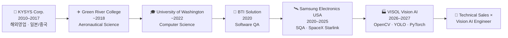

<div align="center"> 
    
<a href="https://github.com/yonghoonchoi88">  </a>

<a href="mailto:y88.choi@gmail.com"></a> <a href="https://www.linkedin.com/in/yonghoon-choi-452241226"></a>  

검증하는 엔지니어가 만드는 Vision AI · I build vision systems the way a QA engineer would test them.

</div>

---

## 👋 About me

**삼성전자 미국법인**에서 **SpaceX Starlink** 위성·모바일 네트워크 품질 검증과 Python 자동화 테스트 툴 개발을 이끈 **SQA 엔지니어**이자,
일본·중국 시장을 개척한 **7년 차 B2B 해외영업** 출신입니다.
지금은 이 두 경험을 들고 **현장 데이터 기반 Vision AI**로 영역을 넓히고 있습니다.

- 🛰️ **Samsung Electronics USA** (2020.12 – 2025.09) — SQA Software Engineer, TMO · VZW · AT&T 위성 네트워크 자동화 테스트 프레임워크
- 🧪 **BTI Solution USA** (2020.06 – 2020.12) — Software QA Tester, 4CC · 5CC · ULCA 차세대 기능 검증
- 💼 **KYSYS Corporation** (2010.03 – 2017.03) — 해외사업팀 매니저, 일본·중국 수출, 총매출 **15%(약 400만 달러)** 성장
- 🎓 **University of Washington** — B.S. Computer Science (2022.08), **GPA 3.9 / 4.0 · Dean's List**
- ✈️ **Green River College** — Aeronautical Science (항공 운항 & 정비, 2018.06), **GPA 4.0 / 4.0**
- 🏭 **비솔(VISOL)** — 현장 데이터 기반 Vision AI & 산업분야 Vertical AI 융합 전문가 양성 (2026.07 – 2027.02, 전일제)
- 🌎 북미 거주 **15년**, 미국 현지 근무 약 5년 — 영어 업무 및 네이티브 수준 커뮤니케이션

저는 모델을 **"돌아가게"** 만드는 데서 멈추지 않습니다.
**데이터 검수 → 기준선 → 실패 분석 → 변수 하나씩 개선 → 한 번만 보는 Test → 회귀 테스트 → 서빙 → 문서화**까지,
QA에서 몸에 익힌 방식 그대로 끝까지 검증합니다. 그리고 그 기술을 **고객의 언어로 설명하고 파는 법**도 압니다.

---

## 🧭 Career Journey



---

## 🧬 Professional Identity

```text
Satellite / Mobile Network SQA Engineer  (Samsung Electronics USA · SpaceX Starlink)
Test Automation Framework Developer      (Python · Qualcomm QCAT / RCT · Jenkins)
Machine Vision Inspection Developer      (OpenCV · Rule-based OK/NG)
Deep Learning Vision Engineer            (YOLO11 · ResNet-18 Fine-tuning · Grad-CAM)
AI Model Serving Backend Developer       (FastAPI · Celery · Redis · PostgreSQL · Docker)
Data Labeling QA Tool Builder & Team PM  (900장 교차검수 · PR 130건 리뷰/머지)
B2B Overseas Sales Manager               (Japan · China · +15% revenue)
```

서로 떨어져 보이는 경험을 **"믿을 수 있는 AI 검사 시스템을 만들고, 설명하고, 고객에게 전달하는 일"** 하나로 연결하는 것이 제 강점입니다.

- **QA × AI** — 테스트 설계, 회귀 테스트, 장애 테스트로 모델과 서비스의 신뢰성을 숫자로 증명
- **Data × Label** — 라벨 검수 도구를 직접 만들어 데이터 품질부터 바로잡음 (기존 라벨 52% 수정)
- **Model × Serving** — 학습에서 끝나지 않고 동기/비동기 API, 캐시, DB 기록, 컨테이너 배포까지
- **Tech × Sales** — 7년 해외영업 경험으로 기술을 고객의 문제와 언어로 번역

---

## 🛠️ Core Expertise

### 🛰️ Network SQA & Test Automation
- **SpaceX × T-Mobile 위성 프로젝트** 전 단계(기획 → 배포) 테스트 환경 설계, 통합 검증, 시나리오 운영 주도
- **Starlink · Skylo(VZW) · Globalstar(iPhone)** 등 다중 위성 서비스 플랫폼 통신 프로토콜 검증 및 품질 지표 개선
- Python 기반 **멀티 네트워크 자동화 테스트 프레임워크** 구축, 통신사별(VZW · TMO) 커스텀 시나리오 최적화
- **QCAT · RCT · Qualcomm Toolset** 연동 로깅·패킷 분석 자동화 파이프라인으로 회귀 테스트 효율 향상
- 4CC · 5CC · ULCA 등 차세대 기능 실시간 성능 검증 (5G / 4G / Satellite)

### 🏭 Machine Vision (Classical)
- ROI → 전처리(Contrast · Blur) → 이진화(Threshold · **Otsu**) → **Morphology · Contour** → 특징 측정
- **YCrCb · HSV** 색공간 분리, **Distance Transform**, 다중 원 샘플링 등 학습 없는 **CPU 실시간** 검사
- 스마트폰 IP Webcam(MJPEG) 실시간 입력, 결과 안정화(5프레임 중 3프레임 투표), **Rule 기반 OK/NG**

### 🧠 Deep Learning Vision
- **Ultralytics YOLO11n** 이물 검출 — 촬영 세션 단위 Split으로 **Data Leakage 방지**, 실패 분석 기반 개선
- **Hugging Face ResNet-18 Fine-tuning** — Head-only → Backbone 동결 해제 → 증강, 단계별 실험
- **Grad-CAM** · OpenCV HSV 분석으로 오분류 원인 진단, mAP · Confusion Matrix · P/R/F1 평가
- Val / Test 분리 원칙 — 최종 Test는 **단 1회**만 평가

### ⚙️ AI Serving & Backend
- **FastAPI** 동기 추론 API + **Redis** 캐시 (캐시 응답 시간 **91% 단축**)
- **Celery** 비동기 작업 (접수 **9.1 ms**) + **PostgreSQL** 작업 이력, **Docker Compose 4 services** 배포
- 실환경 · 장애 테스트 **27/27 PASS**, 모델 교체 시나리오 검증

### 📊 Data & Machine Learning
- pandas · NumPy 데이터 분석 리포트, scikit-learn 회귀/분류, **Kaggle** (House Prices · Spaceship Titanic)
- California Housing 선형회귀 (R² **0.664**)

### 💻 CS Fundamentals
- **C++** — 이진 탐색 트리 기반 은행 거래 시스템, **Dijkstra** 최단경로 · DFS 그래프 ADT
- **Python OOP** · **JavaScript**(Solana Pay SPL 토큰 결제) · **SQL** · HTML/CSS

---

## 🧰 Tech Stack

**Languages**<br/>


**Vision / AI**<br/>


**Data**<br/>


**Serving / Infra**<br/>


**QA / Telecom / Collaboration**<br/>


---

## 🏆 Selected Achievements

| Area | Achievement |
|---|---|
| 🛰️ Satellite QA | **SpaceX × T-Mobile** 위성 프로젝트 기획–배포 전 단계 테스트 환경 설계 · 통합 검증 주도 (Samsung Electronics USA) |
| 🤖 Test Automation | Python 멀티 네트워크 자동화 테스트 프레임워크 + QCAT/RCT 로그·패킷 분석 자동화 파이프라인 구축 (2022–2025) |
| 💼 Overseas Sales | 일본·중국 해외영업 전략으로 총매출 **15%(약 400만 달러)** 성장, **2년 연속 최고 매출** · 고객 만족도 1위 |
| 🎓 Academics | UW Computer Science **GPA 3.9 · Dean's List** / Green River College Aeronautical Science **GPA 4.0** |
| 🌱 Classification | 콩잎 질병 ResNet-18 — Val **0.767 → 0.993**, 최종 Test **0.953**, 병든 잎 놓침 Val **11 → 1** / Test **0** |
| ⚙️ Serving | FastAPI + Redis 캐시 응답 **−91%** · Celery 비동기 접수 **9.1 ms** · 실환경 테스트 **27/27 PASS** |
| 🥬 Detection | 조각김치 이물 YOLO11n — Val mAP50 **0.622 → 0.756**, 미검출 **159 → 60건** (5인 팀 PM) |
| 🏷️ Data Quality | 라벨 검수 도구 직접 개발 — **900/900** QA PASS, 기존 라벨 **52%(469장)** 수정, PR 리뷰·merge **130건** |
| ✋ Machine Vision | 실시간 손가락 개수 검사 — 정확도 **0.48 → 0.92**, 회귀 테스트 포함 **pytest 41건** |

---

## 🚀 Featured Projects

### 🛰️ Automation Network Testing Tool — *Samsung Electronics USA (2022.04 – 2025.09, 사내 비공개)*
> SpaceX 위성용 삼성 모바일 기기 자동화 테스트 시스템

- 자동화 테스트 시스템 모듈 개발 및 지속적 유지보수
- Python 기반 멀티 네트워크 테스트 프레임워크, 통신사별(VZW · TMO) 커스텀 시나리오 최적화
- RCT · QCAT · Qualcomm Testing Tools 연동 로깅 · 패킷 분석 자동화 파이프라인
- `Python` `Qualcomm QCAT/RCT` `Jenkins` `Jira` `5G/4G/Satellite Protocol`

### 🥬 [kimchi-foreign-object-detection](https://github.com/yonghoonchoi88/kimchi-foreign-object-detection) — 김치 제조 공정 이물 검출 (2026.07 – 2026.11, 5인 팀 PM)
> 식품 공장 현장 데이터 900장 · **라벨 검수 → YOLO11n 학습·평가 → 자동 라벨 → 사람 재검수** 한 사이클

- Python · tkinter **라벨 검수 도구** 개발 및 교차검수 규칙 설계, 기존 라벨 **52%(469장)** 수정 · QA PASS **900/900**
- 촬영 세션 단위 Split으로 **Data Leakage 방지**, 실패 분석 기반 개선으로 Val mAP50 **0.622 → 0.756**
- PR 리뷰·merge **130건**으로 팀 작업 통합, Acceptance Test **33/33**, NDA 데이터 보안 관리
- `YOLO11n` `PyTorch` `CUDA` `pandas` `tkinter` `GitHub PR workflow`

### 🌱 [Soybean_Leaf_Identifier](https://github.com/yonghoonchoi88/Soybean_Leaf_Identifier) — 콩잎 질병 분류 AI 서비스 (2026.09 – 2026.10)
> 1,295장 · **반점병 / 녹병 / 정상** 3클래스 분류 + 프로덕션형 서빙

- Backbone 동결 해제 · Train 증강을 단계별로 실험해 Val **0.767 → 0.993**, 최종 Test **0.953** (1회 평가)
- FastAPI · Redis 캐시 · Celery 비동기 · PostgreSQL을 **Docker Compose 4 services**로 배포
- 장애 테스트 포함 실환경 테스트 **27/27 PASS**, Grad-CAM · HSV 분석으로 오분류 원인 진단
- `PyTorch` `Transformers` `FastAPI` `Celery` `Redis` `PostgreSQL` `Docker`

### ✋ [finger_counter](https://github.com/yonghoonchoi88/finger_counter) — 실시간 손가락 개수 검사 시스템 (2026.10)
> 생산 라인의 **수량·누락 검사** 개념을 적용한 규칙 기반 비전 검사, 0–5개 판정 및 목표 개수 **OK/NG**

- YCrCb 피부 분리(Otsu) · Distance Transform 손바닥 검출 · 다중 원 샘플링, **GPU 없이 CPU 실시간**
- 소매에 잘린 손목 오검출 원인을 찾아 실제 사진 정확도 **0.48 → 0.92**, 회귀 테스트 포함 **pytest 41건**
- FastAPI 기반 스마트폰 IP Webcam MJPEG 스트리밍, 브라우저에서 ROI 지정하는 웹 대시보드
- `OpenCV` `FastAPI` `pytest` `NumPy`

### 🍾 [bottle_cap](https://github.com/yonghoonchoi88/bottle_cap) — 병뚜껑 체결 여부 머신비전 검사
> 영상 입력 → ROI → 전처리 → 이진화 → Morphology/Contour → 특징 측정 → **Rule 기반 OK/NG**

- 이미지 · 동영상 · 스마트폰 실시간 입력, Day 단위 학습 일지와 Parameter 리포트
- `OpenCV` `NumPy` `WSL Ubuntu 22.04`

---

## 🔬 In Progress

| Project | Description | Status |
|---|---|---|
| 🐾 **MyPetCheck (마이펫첵)** (팀) | AI Hub 데이터 기반 반려동물 **안구 질환 사전 체크** 스마트폰 앱 — 1단계 개/고양이 구분 모델(Hugging Face 사전학습), 창업 지원사업 도전 검토 | 🟡 개발 중 |
| 🏀 **3D 스켈레톤 행동 비교** (팀) | 비솔 모캡 3D vs CCTV 2D 스켈레톤 비교 — **농구 심판 수신호 인식** | 🟡 개발 중 |
| 🧵 **surface_anomaly** | 정상 이미지만으로 학습하는 표면 결함 **이상 탐지** + 히트맵 시각화 (합성 데이터) | 🟡 진행 중 |
| 📜 **정보처리기사** | 자격증 준비 | 🟡 학습 중 |

---

## 📚 More Repositories

<details>
<summary><b>📊 Data Analysis & Machine Learning</b></summary>

| Repository | Description |
|---|---|
| [california_housing](https://github.com/yonghoonchoi88/california_housing) | 캘리포니아 주택가격 선형회귀 — MAE 0.4796 · RMSE 0.6635 · R² 0.664 |
| [house_price](https://github.com/yonghoonchoi88/house_price) | Kaggle House Prices — 회귀 모델 및 submission |
| [Spaceship-Titanic](https://github.com/yonghoonchoi88/Spaceship-Titanic) | Kaggle Spaceship Titanic — EDA, 트리 모델 하이퍼파라미터 탐색 |
| [Python_DataAnalyze](https://github.com/yonghoonchoi88/Python_DataAnalyze) | 매출 · 대출 · 날씨 데이터 분석 리포트 3종 |
| [devpractice](https://github.com/yonghoonchoi88/devpractice) | AI 1차시 노트북 · Git 브랜치 협업 실습 |

</details>

<details>
<summary><b>🐍 Python Applications</b></summary>

| Repository | Description |
|---|---|
| [refrigerator_manager](https://github.com/yonghoonchoi88/refrigerator_manager) | OOP · JSON 영속화 냉장고 관리 (입고 · 섭취 · 폐기 · 유통기한 이력) |
| [prj10minigames](https://github.com/yonghoonchoi88/prj10minigames) | 업다운 · 가위바위보 · 로또 · 주사위 홀짝 · 반응속도(tkinter GUI) 미니게임 5종 |
| [Linux_Quiz](https://github.com/yonghoonchoi88/Linux_Quiz) | 랜덤 출제 · 채점 Linux 명령어 퀴즈 |

</details>

<details>
<summary><b>💻 C++ · CS Fundamentals (UW)</b></summary>

| Repository | Description |
|---|---|
| [Bank](https://github.com/yonghoonchoi88/Bank) | 거래 큐 처리 · 이진 탐색 트리 기반 계좌/펀드 관리 은행 시스템 |
| [Dijkstra-s-Shortest-Path](https://github.com/yonghoonchoi88/Dijkstra-s-Shortest-Path) | Dijkstra 최단경로(경로 복원) · DFS · 인접 행렬/리스트 그래프 ADT |
| [Linux-File-System](https://github.com/yonghoonchoi88/Linux-File-System) | Linux 파일 시스템 구현 학습 (fork) |

</details>

<details>
<summary><b>🌐 Web · Web3</b></summary>

| Repository | Description |
|---|---|
| [Solana-pay](https://github.com/yonghoonchoi88/Solana-pay) | Solana Pay 트랜잭션 요청/응답 · SPL 토큰(USDC) 결제 |
| [myrepo](https://github.com/yonghoonchoi88/myrepo) | HTML/CSS 카페 웹사이트 |

</details>

---

## 🧭 How I Work

```text
Problem Definition
→ Data Check & Labeling QA
→ Baseline
→ Failure Analysis
→ One-Variable-at-a-Time Improvement
→ Frozen Test (once)
→ Regression Test
→ Serving & Deployment
→ Documentation (KR / EN)
→ Explain it to the customer
```

> QA 엔지니어로 일하며 배운 한 가지 — **"측정하지 않은 개선은 개선이 아니다."**
> 그래서 모든 프로젝트에 기준선, 실패 원인, 개선 폭, 남은 한계를 숫자와 함께 남깁니다.

---

## 📈 GitHub Activity

<div align="center">

<picture>
  <source media="(prefers-color-scheme: dark)" srcset="https://streak-stats.demolab.com?user=yonghoonchoi88&theme=dark&background=0D1117&hide_border=true&ring=79A6E8&fire=E95420&currStreakLabel=79A6E8">
  
</picture>

</div>

---

## 📫 Contact

<div align="center">

<a href="mailto:y88.choi@gmail.com"></a>
<a href="https://www.linkedin.com/in/yonghoon-choi-452241226"></a>
<a href="https://github.com/yonghoonchoi88"></a>

*Open to: Vision AI Engineer · AI QA / MLOps · Technical Sales (Vision AI)*

</div>

> *From testing networks between satellites and phones, to testing what a camera sees on the factory floor — I make sure it actually works.*
